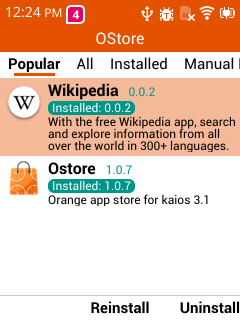
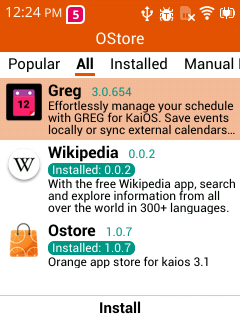
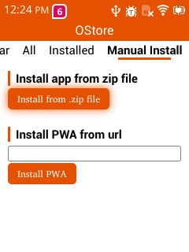

# OStore-Solid

Orange app store for KaiOS 3.1

This app is built into the system image of [nokia 2780 flip](https://github.com/gogogoghost/nokia-2780-flip-jailbreak-tutorial).

## Screenshots





## Where are the apps from?

The OStore catalogue at `https://dl-ostore.yexm.eu.org/` is the only source.

- My porting and packaging
- Uploads by authors

OStore does not read a third-party catalogue. Every listed app has a stable
`<id>_update.webmanifest` pointer; AppsManager mode installs the signed variant
(`<id>_update_JscalatedSigned.webmanifest`) and the system records that URL, so
later update checks use the same source. Local modes install the unsigned
`<id>_<version>.zip`.

## How to upload your app

OStore has an api to publish your newest version.

https://api-ostore.yexm.eu.org/publish

POST multipart/form-data

| Field | Type   | Description          |
|-------|--------|----------------------|
| id    | string | App's ID             |
| file  | file   | Zip File             |
| sign  | file   | The ED25519 signature binary of the ZIP file  |

But for the first version you have to send the zip file and the DER format ed25519 public key to my email: **jaxyang39@gmail.com**.

I will publish your first version and then you can upgrade by yourself.

The publishing service rebuilds the catalogue, the unsigned update pointer, and
the signed update pointer. See the companion `ostore-worker` repository for the
artifact layout and retention rules.

## Install modes

OStore probes all four backends on every launch, keeps the saved mode while it
is still detected, otherwise uses the first detected one (canonical order
below), and keeps the last backend (`appscmd`) for a retry when none is
detected. The choice is stored in `localStorage`; Settings shows the current
mode and detected backends, with undetected rows dimmed and skipped. Restart
OStore to probe again.

| Mode | Catalogue entry | Manual tab |
| --- | --- | --- |
| `AppsManager` | signed update manifest (`package_path` → ZIP) | PWA manifest URL |
| `Sideload` | unsigned `<id>_<version>.zip` | local ZIP or PWA URL |
| `Flipfull` | unsigned `<id>_<version>.zip` via its bridge | local ZIP or PWA URL |
| `appscmd` | unsigned `<id>_<version>.zip` via the local daemon | local ZIP or PWA URL |

AppsManager installs a catalogue entry with `installPackage`: the signed update
manifest names the ZIP in `package_path`, and the ZIP and its signature are
downloaded. The Manual tab's URL field is passed to `installPwa`, which installs
a hosted PWA manifest and does not read `package_path`; a manifest that points
to a ZIP is an update manifest and OStore uses it for catalogue entries.

AppsManager records the signed pointer as the app's update URL. It can update
only an app installed from that same pointer: the catalogue offers `Upgrade`
when its version is higher. A newer version installed from another source
offers `Migrate`, which installs the signed package as a second copy; remove the
old copy from the Launcher afterwards (its local data is deleted). Same-version
and downgrade actions are not offered: the system refuses `installPackage` for
an already-installed update URL and only allows `update` to a newer version.

Local modes install the catalogue's unsigned ZIP and overwrite an existing
app, so they offer Reinstall, Downgrade, and Upgrade. A ZIP on the memory card
always uses a local mode because AppsManager cannot install local files. A URL
under Manual Install is installed as a PWA through the active mode.

If a running operation reports that its service is unavailable, OStore drops
that mode, tries the next one, and saves the result.

Network requests use `fetch(..., { mode: 'no-cors' })`. On KaiOS 3 the
`systemXHR` permission makes that a readable privileged response, which is
required because the OStore download host does not send CORS headers.

## Development

```bash
cp .env.example .env
bun install
bun run dev
```

`bun run test` runs the catalogue, install-mode, AppsManager, and matching
checks. `./build.sh` produces `dist/ostore.zip` with `manifest.webmanifest` at
the ZIP root.
